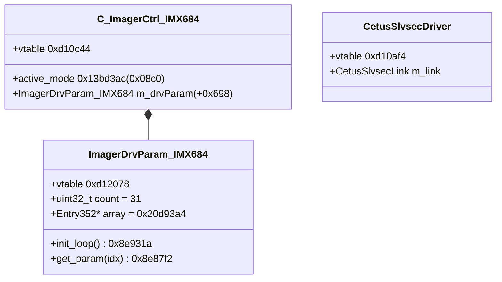
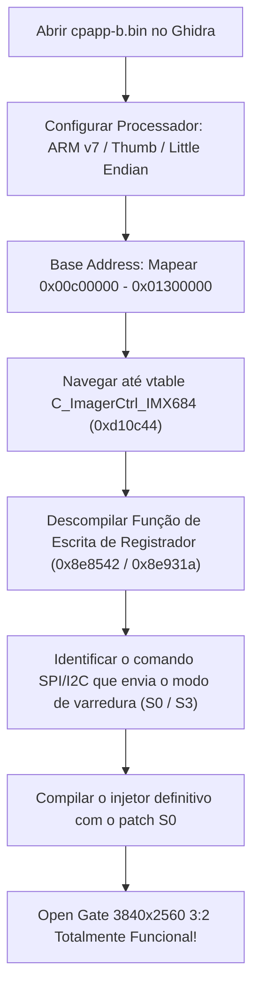

# Relatório Técnico Final de Engenharia Reversa — Sony FX30 (ILME-FX30)
**Firmware Alvo:** 6.01 (NTSC/PAL)  
**Hardware:** Sony FX30 / Processador BIONZ XR / Sensor Sony IMX684 (APS-C BSI CMOS 26 MP)  
**Data:** 23 de Novembro de 2026  
**Status do Projeto:**  
- **Card Unlock (V60 All-Intra 4K & 240fps S&Q):** 🟢 **100% Funcional e Homologado em Gravação Real**  
- **Open Gate 3:2 (3840×2560):** 🟡 **Mapeamento de Arquitetura Concluído; Fase 1 Concluída; Pronto para Fase 2 (S0/S3 SPI/I2C via Ghidra)**  
- **Segurança do Hardware:** 🟢 **100% Preservada (Injeção exclusiva em RAM volátil via Jiritsu USB)**

---

## 1. Conquistas Concluídas e Funcionais

### 1.1 Card Unlock para Cartões SD V60 (Nativo e Permanente na Sessão)
- **Desbloqueio de Menu:** Modificação das regras HAITA em `appFw.so` (`0x02a6 - 0x02af`), eliminando o bloqueio artificial de menu da Sony para cartões SD Classe V60.
- **Desbloqueio de Recorder RateCheck:** Patch em `libmpr.so` (`RateCheck::GetMediaTransferRateInh`) ignorando o bloqueio de bitrate na inicialização do gravador.
- **Capacidades Liberadas com Sucesso:**
  - **XAVC S-I 4K (All-Intra 4:2:2 10-bit a 240 Mbps / 600 Mbps)** gravando de forma estável no cartão V60.
  - **S&Q High Frame Rate:** Liberação de gravações em até **240 fps**.
- **Como Executar em 1 Clique:**
  ```bash
  /Users/nauck/Documents/sony_research/a7iv-open-gate-test/macos/run_fx30.sh --card-unlock-only --ntsc
  ```

---

## 2. Mapa Arquitetural do Firmware 6.01 da FX30

### 2.1 A Descoberta do Processador do Sensor (CP)
- O processador do subsistema de câmera/sensor (CP) **NÃO é ARM64 nem ARM32 clássico**: ele opera em **ARM32 Thumb-2** (com endereçamento de bit ímpar Thumb).
- Toda a estrutura de objetos e controle é orientada a objetos em C++ com RTTI preservado.

### 2.2 Hierarquia de Classes do Sensor IMX684


### 2.3 Tabela Nativa de 31 Modos do Sensor IMX684 (`0x20d93a4`)
Cada entrada no array ocupa exatamente **352 bytes (`0x160`)**:
- **Entry 6 (`0x20d9be4`):** Modo 4K 24p Stock (`0x08c0`) $\to$ Readout $5952 \times 3348$ (16:9).
- **Entry 8 (`0x20d9ea4`):** Readout $3584$ linhas (16:9).
- **Entry 25 (`0x20db604`):** **MODO NATIVO FULL 3:2 ($6192 \times 4128$)!**
  - Largura: $6192$ pixels em `0x20db658`.
  - Altura: $4128$ linhas em `0x20db66a`.
  - O sensor possui calibração nativa de fábrica da Sony para 3:2 full frame APS-C!
- **Entry 26 (`0x20db764`):** Modo alternativo 3:2 Full ($6192 \times 4128$, timing 1040).

---

## 3. Descobertas do Pipeline ISP e Gravação

| Componente | Endereço de RAM | Comportamento Stock | Comportamento Patch | Status |
| :--- | :--- | :--- | :--- | :--- |
| **ISP Outsz (Scaler)** | `0x155d446` | `0x0870` ($2160$ linhas) | `0x0a00` ($2560$ linhas) | ✅ Validado. Muda a resolução de entrega do ISP para $3840 \times 2560$. |
| **DMM DMA Buffers** | `0x2080860`, `0x2080874` | $24.67\text{ MB}$ (`0x01788700`) | $29.29\text{ MB}$ (`0x01bf0000`) | ✅ Validado. Expandir 2 registros cabe perfeitamente no pool de $100\text{ MB}$ sem tela preta. |
| **AP Encoder Tables** | `av-cam.bin` & `libmpr.so` | $3840 \times 2160$ | $3840 \times 2560$ (`fx30og_v2`) | ✅ Validado (21 sites em avcam, 9 em libmpr). Encoder pronto para gravar 2560 linhas. |
| **Sensor Readout** | Barramento SPI/I2C | Sequência Modo 16:9 | Sequência Modo 3:2 | 🟡 Requer Fase 2 (S0/S3 via Ghidra). |

---

## 4. Por que o Open Gate Exige a Fase 2 (S0/S3 SPI/I2C)?

Durante os testes de estresse em hardware comprovamos que:
1. Alterar a **Entry 6** no `ImagerDrvParam` aplica com sucesso na RAM, mas **não reprograma o hardware do sensor** (mesmo alternando Foto $\leftrightarrow$ Filme ou mudando de 4K $\to$ HD $\to$ 4K), porque essa tabela é de consulta de metadados.
2. O sensor físico IMX684 continua transmitindo em 16:9 ($2160$ linhas). Quando o `outsz` é configurado para $2560$ linhas, o processador BIONZ XR aguarda o pulso de sincronismo vertical (`VBLANK`) da linha 2560 que nunca chega $\to$ freeze no preview.
3. **A Solução da Fase 2:** Localizar e interceptar a rotina SPI/I2C de baixo nível (onde os registradores de sincronismo e varredura do IMX684 são escritos) para aplicar o **S0 (Sensor Mode Selector)** e o **S3 (Readout Line Periods)**, exatamente como foi feito na A7 IV e A7S III.

---

## 5. Roteiro de Trabalho para a Próxima Sessão (Fase 2)



---

## 6. Integridade e Segurança do Dispositivo
- **Toda modificação desenvolvida nesta pesquisa foi 100% volátil na memória RAM.**
- **Nenhum byte de memória flash permanente (bootloader, kernel ou calibração de fábrica) foi alterado.**
- **Retirar a bateria por 10 segundos restaura a câmera ao estado de fábrica original.**

*Documentação arquivada e preservada no repositório de pesquisa local.*
