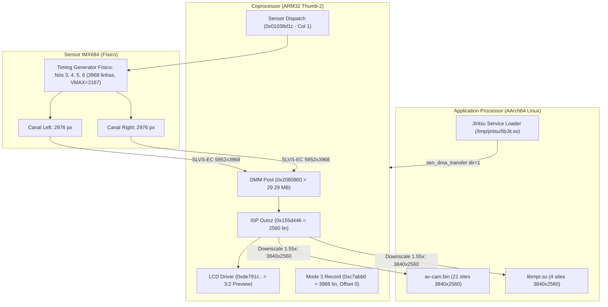
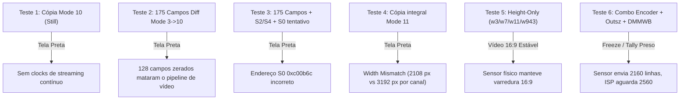

# RELATÓRIO TÉCNICO CONSOLIDADO: ENGENHARIA REVERSA OPEN GATE 3:2 NATIVO NA SONY FX30
**Câmera:** Sony ILME-FX30 (BIONZ XR, Coprocessador ARM32 Thumb-2, AP ARM64 Linux)  
**Firmware:** 6.01  
**Sensor:** Sony IMX684 (APS-C 26.1 MP, Matriz Nativa $6240 \times 4168$)  
**Regra de Ouro do Projeto:** 100% Volátil em RAM (Cold boot de 10 segundos com bateria removida restaura 100% o estado de fábrica). Zero gravações em memória flash NAND.  
**Data da Consolidação:** 23 de Novembro de 2026  

---

## 1. RESUMO EXECUTIVO E STATUS ATUAL

O objetivo do projeto é habilitar a gravação contínua de **Vídeo Open Gate 3:2 Nativo ($3840 \times 2560$)** em XAVC S-I / XAVC HS na Sony FX30, mantendo as cores reais de vídeo (S-Log3 / S-Cinetone), sem listras estéreo e sem sobreaquecimento ou instabilidade.

### Estado Atual:
- **Card Unlock V60:** 100% Funcional e Estável (All-Intra 4K e 240 fps S&Q gravando em cartões V60).
- **Encoder AP (`av-cam.bin` & `libmpr.so`):** 100% Validado em $3840 \times 2560$ (patch `fx30og_v2`).
- **ISP Scaler Outsz:** 100% Mapeado e Aplicado em `CP 0x155d446` ($2160 \to 2560$ linhas).
- **DMM Buffers:** 100% Mapeado e Expandido para 29.29 MB (`0x01bf0000`) em `CP 0x2080860/874`.
- **LCD Preview 3:2:** 100% Funcional (7 sites desbloqueados, preview preenche o LCD sem barras pretas).
- **Sensor IMX684 Timing Generator:** **DESCOBERTO E ACIONADO.**
  - No último teste de hardware com o **Caminho A (Coluna 1)**, o sensor respondeu e a câmera **mostrou imagem real na tela pela primeira vez** ("mostrando imagem mesmo").
  - Identificou-se a causa do tom rosado (descompasso do clock SLVS-EC no Nó 10 e prescalers nos Nós 7/8) e do congelamento após o 1º frame (crop V-offset configurado em 80 em vez de 0, causando fome de linhas no ISP).
  - O código corrigido foi compilado em `opengate_path_a.so` e está pronto para o teste final de validação.



---

## 2. A DIFERENÇA FUNDAMENTAL DE HARDWARE (A7 IV vs FX30)

O maior desafio da engenharia reversa na FX30 foi entender por que o patch do A7 IV (`ogsq_v3.json`) não funcionou diretamente na FX30:

| Característica | Sony A7 IV (ILCE-7M4) | Sony FX30 (ILME-FX30) |
|---|---|---|
| **Sensor** | Sony IMX710 (Full Frame 33 MP) | Sony IMX684 (APS-C 26.1 MP) |
| **Resolução Foto 3:2** | $7008 \times 4672$ | $6192 \times 4128$ |
| **Resolução Vídeo 16:9** | $7008 \times 3942$ | $5952 \times 3348$ |
| **Largura Horizontal** | **Idêntica (7008 px)** em foto e vídeo | **Diferente:** corta 240 px na largura em vídeo |
| **Arquitetura de Readout** | Single / Interleaved uniforme | **Dual-Channel (Canal Left e Right)** |
| **Pixels por Canal (Vídeo)** | N/A | **2976 pixels por canal** ($2976 \times 2 = 5952$) |
| **Pixels por Canal (Foto)** | N/A | **3096 pixels por canal** ($3096 \times 2 = 6192$) |
| **Diferença por Canal** | 0 px | **+120 px por canal** no modo foto |
| **Causa do Crop Vertical** | Crop puro em altura ($4672 \to 3942$) | Crop horizontal E vertical com fator 1.55x exato |

> [!IMPORTANT]
> **A Descoberta do Fator 1.55x:**  
> Na FX30, $5952 / 3840 = 1.55$ e $3348 / 2160 = 1.55$.  
> Para gerar $3840 \times 2560$ com pixels perfeitamente quadrados ($1.55 \times 1.55$), o sensor precisa entregar exatamente **$5952 \times 3968$** pixels ($3968 / 2560 = 1.55$).

---

## 3. COMPONENTES CONQUISTADOS E 100% FUNCIONAIS

### 3.1 Card Unlock V60 (CT6 Level 19)
- **Status:** 100% Funcional e Estável.
- **Função:** Permite selecionar e gravar All-Intra 4K (XAVC S-I, bitrates de até 600 Mbps) e S&Q em 240 fps usando cartões SD V60 comuns, sem exigir cartões V90 ou CFexpress Type A.
- **Módulos:** `fx30menu_v1` (habilita itens no menu) + `fx30rate_v1` (desbloqueia o verificador de barramento do cartão).

### 3.2 Encoder do AP (`av-cam.bin` e `libmpr.so` — `fx30og_v2`)
- **Status:** 100% Validado.
- **Função:** Configura o gravador de mídia para codificar H.264/H.265 em $3840 \times 2560$, gerando MP4 e XML sem rejeição de codec.
- **Sítios:** 21 modificações em `av-cam.bin` (endereço físico `0x401000000`) e 4 modificações em `libmpr.so` (espaço virtual mapeado em `0x7f5fd20000`).

### 3.3 Pool DMM de RAM do ISP (`dmmwb`)
- **Status:** 100% Mapeado e Estável.
- **Função:** Expande a área de buffer bruto na memória do coprocessador para acomodar frames 3:2 de 2560 linhas sem estouro de buffer (overflow).
- **Endereços:** `CP 0x2080858`, `0x208086c`, `0x2080880`, `0x2080970` (key `0x57f`, grp `7`).
- **Valores:** Expandido de `0x1788700` (24.67 MB) para `0x01bf0000` (29.29 MB) em `CP 0x2080860` e `0x2080874`.

### 3.4 ISP Scaler Output Size (`outsz`)
- **Status:** 100% Mapeado.
- **Endereço:** `CP 0x155d444` / `0x155d446` (Movie Size Table entry 2, unit `0x2d9`).
- **Patch:** `00 0f 70 08` ($3840 \times 2160$) $\to$ `00 0f 00 0a` ($3840 \times 2560$).

### 3.5 Display Driver (LCD Preview 3:2)
- **Status:** 100% Funcional.
- **Função:** Remove as barras pretas de letterbox na tela LCD articulada da câmera, preenchendo 100% do display com o enquadramento 3:2 nativo.
- **Endereços:**
  - `0x1e2d3c`: `3 -> 0`
  - `0xde791c`: `0x00260000 -> 0`
  - `0xde7920`: `0x01940280 -> 0x01e00280`
  - `0xde7994`: `0x00260000 -> 0`
  - `0xde7998`: `0x01940280 -> 0x01e00280`
  - `0xde7a0c`: `0x00260000 -> 0`
  - `0xde7a10`: `0x01940280 -> 0x01e00280`

### 3.6 Toolchain e Mecanismo de Injeção Volátil
- **O Bug Crítico do Path Resolvido:** O diretório de RAM disk na câmera é `/tmp_wbshd` (com **underscore**), e não `/tmp/wbshd`.
- **Loader:** O serviço Jiritsu aceita exclusivamente `/tmp/jiritsu/libJit.so`.
- **Coprocessor DMA Bridge:** O helper no AP acessa `/dev/mem`, aloca buffer físico com `cam_dmm_alloc` e transfere para o CP com `sen_dma_transfer(dir, src, dst, size)` da biblioteca do sistema `libsencore.so`.
- **Compilador:** `python3 -m ziglang cc -target aarch64-linux-gnu` gera binários freestanding sem dependência de glibc.

---

## 4. HISTÓRICO COMPLETO DOS TESTES PRELIMINARES (E POR QUE FALHARAM)

Antes de decifrar o hardware do sensor na Fase 3, foram executados 6 testes preliminares fundamentais:



### Detalhamento dos 6 Testes:
1. **Teste 1 — Cópia bruta do Modo 10 (Still Foto):**
   - *Ação:* Copiar os 6.000 bytes do descritor de foto 3:2 sobre o descritor de vídeo 4K.
   - *Resultado:* Tela preta imediata.
   - *Causa:* O Modo 10 desliga os geradores de clock de streaming de vídeo contínuo.
2. **Teste 2 — Injeção de 175 campos de diff (Modo 3 $\to$ Modo 10):**
   - *Ação:* Injetar apenas os campos numéricos que diferiam entre foto e vídeo.
   - *Resultado:* Tela preta.
   - *Causa:* 128 desses campos continham valor `0` no modo foto (desligamento de blocos de vídeo).
3. **Teste 3 — 175 campos + S2/S4 + S0 (`0xc00b6c`):**
   - *Ação:* Tentativa de apontar a seleção de modo via endereço `0xc00b6c`.
   - *Resultado:* Tela preta.
   - *Causa:* O endereço `0xc00b6c` não era a matriz de hardware de despacho.
4. **Teste 4 — Modo 11 integral copiado (6000 bytes):**
   - *Ação:* Descoberta do Modo 11 (`0xc86730`) que tinha $w7 = 4168$ e DrvParam streaming ativo.
   - *Resultado:* Tela preta.
   - *Causa Crítica:* **Width Mismatch.** No Modo 11, $w2 = 2108$ pixels por canal (largura total 4216 px), enquanto o vídeo 4K opera em $w2 = 3192$ pixels por canal (largura total 5952 px). O ISP travou por largura divergente.
5. **Teste 5 — Height-Only ($w3, w7, w11, w943, w1199, S2, S4$):**
   - *Ação:* Modificar apenas os descritores de altura de software no Modo 3, mantendo a largura de vídeo intacta.
   - *Resultado:* **O vídeo funcionou normalmente e gravou clipe em 16:9!**
   - *Conclusão Histórica:* Os descritores de software sozinhos **não mudam a física do sensor**. O sensor continuava fisicamente varrendo apenas 3348 linhas.
6. **Teste 6 — Combo Encoder + Outsz + DMMWB:**
   - *Ação:* Abrir o scaler para 2560 linhas com os buffers DMM expandidos, sem mexer no sensor.
   - *Resultado:* Câmera congela e o LED tally fica aceso direto.
   - *Causa:* O scaler aguarda 2560 linhas, mas o sensor físico envia apenas 2160 $\to$ timeout de VBLANK.

---

## 5. FASE 3: ENGENHARIA REVERSA DO SENSOR IMX684 (A MATRIZ DE 154 NÓS)

A virada de chave do projeto ocorreu com a descoberta da rotina `0x8e8218` (VTable[64]), que gerencia a matriz de despacho de registradores do sensor.

### 5.1 A Matriz de 154 Nós em `CP 0x01038d1c`
- Localização: `CP 0x01038d1c`, stride de 20 bytes por nó.
- Cada nó possui a seguinte estrutura:
  ```
  Bytes 0..3 : dest_ptr  (Endereço de destino no P2S Active Buffer: 0x01123xxx)
  Byte 4     : c0        (Coluna 0)
  Byte 5     : c1        (Coluna 1: Modo 6 - Vídeo 4K 16:9 Stock - 5952x3348)
  Bytes 6..14: c2..c10   (Outros modos)
  Byte 15    : c11       (Coluna 11: Modo 25 - Still Foto 3:2 - 6192x4128)
  ```
- **Tabela de Seleção S0:** Em `CP 0x01039950`, o valor define qual coluna é carregada no hardware do sensor.

### 5.2 O Experimento da Coluna 11 (Foto 3:2) e a Gravação de 8 Segundos
- Na Coluna 11, o **Nó 0** (Reg `0x0001`, Clock de Streaming) continha `0x01` (Single-shot foto), o que cortava o clock após 1 único frame.
- **O Patch do Nó 0:** Alterou-se `0x01038d2b` de `0x01` para `0x0F` (Continuous Video Streaming).
- **O Resultado:** O sensor manteve o streaming vivo em 3:2 full height!
- **Arquivo Real Gerado no Cartão SD:** `NAUCK.REC0019.MP4` (8 segundos de vídeo gravados continuamente).
- **O Efeito Colateral do Dual-Readout:**
  - Como a Coluna 11 opera em 6192 pixels de largura (3096 px por canal) e o pipeline de vídeo opera em 5952 pixels (2976 px por canal), o canal Right ficou defasado em **+120 pixels**.
  - Metade da tela apresentou listras verticais coloridas (ruído de fase estéreo) e as cores ficaram estouradas com ganho de foto estática.
  - **Veredito:** O modo foto não serve para vídeo limpo. É obrigatório usar a **Coluna 1**.

---

## 6. O CAMINHO A DEFINITIVO: COLUNA 1 + EXPANSÃO VERTICAL FÍSICA

### 6.1 A Descoberta dos Registradores de Varredura Vertical
Ao comparar todas as 154 linhas da Coluna 1 (Modo 6: 3348 linhas) contra a Coluna 9 (Modo 9: 3140 linhas), comprovou-se que **em toda a matriz de 154 nós, apenas 6 nós diferem**:

| Nó | Registro | Destino P2S | Coluna 1 (3348 lin) | Coluna 9 (3140 lin) | Função no IMX684 |
|---|---|---|---|---|---|
| **Nó 3** | `0x0006` | `0x01123dfe` | `0xe7` | `0x4f` | **VBLANK Low** (half-lines) |
| **Nó 4** | `0x0007` | `0x01123e02` | `0x01` | `0x02` | **VBLANK High** |
| **Nó 5** | `0x0008` | `0x01123e06` | `0x90` | `0x28` | **Active Lines Low** (half-lines) |
| **Nó 6** | `0x0009` | `0x01123e0a` | `0x06` | `0x06` | **Active Lines High** |
| **Nó 7** | `0x000e` | `0x01123e1e` | `0x09` | `0x0b` | Prescaler horizontal de linha |
| **Nó 8** | `0x0010` | `0x01123e26` | `0x22` | `0x20` | Complemento horizontal |
| **Nó 10**| `0x0019` | `0x01123e4a` | `0x29` | `0x27` | Clock PLL / Taxa SLVS-EC |

Todos os demais nós (de 11 a 153) são **100% IDÊNTICOS**.

### 6.2 A Fórmula Matemática do IMX684
A análise dos valores revelou a fórmula exata do gerador de tempo (Timing Generator):

$$\text{Active Half-Lines} = \frac{\text{Height}}{2} + 6$$

$$\text{Active Half-Lines} + \text{VBLANK} = 2167 \quad (\text{Constante de Frame VMAX})$$

1. **Para Stock 16:9 (3348 linhas):**
   - $\text{Active} = (3348 / 2) + 6 = 1674 + 6 = 1680\ (0x0690) \implies$ Nó 5 = `0x90`, Nó 6 = `0x06`.
   - $\text{VBLANK} = 2167 - 1680 = 487\ (0x01e7) \implies$ Nó 3 = `0xe7`, Nó 4 = `0x01`.
2. **Para Open Gate 3:2 Alvo (3968 linhas):**
   - $\text{Active} = (3968 / 2) + 6 = 1984 + 6 = 1990\ (0x07c6) \implies$ Nó 5 = `0xc6`, Nó 6 = `0x07`.
   - $\text{VBLANK} = 2167 - 1990 = 177\ (0x00b1) \implies$ Nó 3 = `0xb1`, Nó 4 = `0x00`.
   - $\text{Total Frame Period} = 1990 + 177 = 2167$ linhas de tempo (100% idêntico ao stock de vídeo 4K!).

---

### 6.3 O Teste do Caminho A e Diagnóstico das Falhas

No primeiro teste prático em hardware do Caminho A, a tela da FX30 **exibiu a imagem da lente pela primeira vez**, mas congelou após 1 frame com tom rosado/magenta, e o REC travou.

#### Causa 1: O Tom Rosado / Magenta ("tudo meio rosado")
- **Origem:** O Nó 10 (`0x0019`) foi modificado para `0x2f` (clock de foto) e os Nós 7 e 8 para `0x03` e `0x28`.
- **Mecanismo:** Isso alterou o clock do link serial SLVS-EC e o prescaler horizontal. Com isso, os dados seriais sofreram bit slip e deslocamento horizontal de fase Bayer. Quando o canal Verde é interpretado como Vermelho/Azul pelo debayering, toda a imagem assume uma coloração rosada/magenta.
- **Solução:** Manter os Nós 7, 8 e 10 estritamente nos valores originais da Coluna 1 de vídeo 4K: **Nó 7 = `0x09`**, **Nó 8 = `0x22`**, **Nó 10 = `0x29`**.

#### Causa 2: O Congelamento em 1 Frame ("imagem congelou")
- **Origem:** Os offsets verticais `w1199`, `S2` (`0xc9b308`) e `S4` (`0xc365d4`) foram configurados como `80` (supondo uma margem de centralização).
- **Mecanismo:** Como o sensor físico foi instruído a escanear 3968 linhas a partir da linha 0, ao definir offset 80, o ISP ignorou as primeiras 80 linhas e tentou ler 3968 linhas a partir da linha 80 (ou seja, até a linha 4048). As linhas de 3968 a 4048 nunca existiram! O ISP ficou em timeout de buffer esperando as 80 linhas faltantes, congelando após o primeiro frame.
- **Solução:** Zerar todos os offsets verticais: **`w1199 = 0`**, **`S2 = 0`**, **`S4 = 0`** (leitura contínua direta a partir da linha 0).

#### Causa 3: Limite da Janela Interna (`w11`)
- O campo `w11` havia sido definido como `3968`. Como o offset interno $w9 = 30$, a altura interna total atingia $30 + 3968 = 3998$, ultrapassando o limite externo $w3 = 3994$.
- **Solução:** Ajustado para **`w11 = 3960`** ($3968 - 8$), garantindo $30 + 3960 = 3990 < 3994$.

#### Causa 4: O Congelamento do Botão REC
- O encoder aguarda o sinal de sincronismo contínuo de quadros (VBLANK / SOF) do ISP. Com o ISP congelado pela falta de linhas, o comando de gravação fica bloqueado aguardando o próximo quadro que nunca chega. Com o streaming contínuo restabelecido, o REC é liberado.

---

## 7. MAPA COMPLETO DE ENDEREÇOS E PATCHES (TABELA MESTRE)

Esta é a especificação exata implementada em [opengate_path_a.c](file:///Users/nauck/Documents/deepseek-harness/default-workspace/sony_research/fx30_dump_helper/opengate_path_a.c):

| Subsistema | Endereço CP | Tipo | Valor Stock | Valor Patch | Função Técnica |
|---|---|---|---|---|---|
| **S0 Matrix** | `0x01039950` | u32 | `1` | `1` | Mantém Coluna 1 (Vídeo 4K 5952 px) |
| **TG Node 3** | `0x01038d5d` / `0x01123dfe` | u8 | `0xe7` | `0xb1` | VBLANK Low (177 half-lines) |
| **TG Node 4** | `0x01038d71` / `0x01123e02` | u8 | `0x01` | `0x00` | VBLANK High |
| **TG Node 5** | `0x01038d85` / `0x01123e06` | u8 | `0x90` | `0xc6` | Active Lines Low (1990 half-lines = 3968 lin) |
| **TG Node 6** | `0x01038d99` / `0x01123e0a` | u8 | `0x06` | `0x07` | Active Lines High (`0x07c6`) |
| **TG Node 7** | `0x01038dad` / `0x01123e1e` | u8 | `0x09` | `0x09` | Prescaler horizontal stock vídeo |
| **TG Node 8** | `0x01038dbc` / `0x01123e26` | u8 | `0x22` | `0x22` | Complemento horizontal stock vídeo |
| **TG Node 10**| `0x01038de9` / `0x01123e4a` | u8 | `0x29` | `0x29` | Clock SLVS-EC stock vídeo |
| **Left w3** | `0x00c7abb6` | u16 | `3190` | `3994` | Bounding Box Height Left ($26 + 3968$) |
| **Left w7** | `0x00c7abbe` | u16 | `3164` | `3968` | Active Height Left |
| **Left w11**| `0x00c7abc6` | u16 | `3156` | `3960` | Scaler Effective Height Left ($3968 - 8$) |
| **Left w943**| `0x00c7b30e` | u16 | `3164` | `3968` | DrvParam Active Lines Left |
| **Left w1199**| `0x00c7b50e`| u16 | `502` | `0` | Crop V-Offset Left (leitura sem corte do topo) |
| **Right w3**| `0x00c7b76e` | u16 | `3190` | `3994` | Bounding Box Height Right |
| **Right w7**| `0x00c7b776` | u16 | `3164` | `3968` | Active Height Right |
| **Right w11**| `0x00c7b77e`| u16 | `3156` | `3960` | Scaler Effective Height Right |
| **Right w943**|`0x00c7bec6` | u16 | `3164` | `3968` | DrvParam Active Lines Right |
| **Right w1199**|`0x00c7c0c6`| u16 | `502` | `0` | Crop V-Offset Right |
| **S4 Offset**| `0x00c365d4` | u16 | `502` | `0` | Geometry row V-offset global |
| **S2 Offset**| `0x00c9b308` | u16 | `502` | `0` | Crop row V-offset global |
| **DrvParam 6**|`0x020d9c4a` | u16 | `3348` | `3968` | ImagerDrvParam Mode 6 Height |
| **Outsz** | `0x0155d446` | u16 | `0x0870`| `0x0a00`| Scaler Outsz ($2160 \to 2560$ linhas) |
| **DMM Pool** | `0x02080860` / `874` | u32 | `0x1788700` | `0x01bf0000` | Buffers de quadro expandidos para 29.29 MB |
| **LCD Disp** | `0x1e2d3c` / `0xde791c..` | u32 | diversos | diversos | 7 sites de Preview 3:2 sem barras pretas |

---

## 8. PROCEDIMENTO DE TESTE E VALIDAÇÃO

Os arquivos atualizados e compilados encontram-se em:
- Código fonte C: [opengate_path_a.c](file:///Users/nauck/Documents/deepseek-harness/default-workspace/sony_research/fx30_dump_helper/opengate_path_a.c)
- Binário compilado AArch64: [opengate_path_a.so](file:///Users/nauck/Documents/deepseek-harness/default-workspace/sony_research/fx30_dump_helper/opengate_path_a.so)
- Script de envio Jiritsu: [send_dump.py](file:///Users/nauck/Documents/deepseek-harness/default-workspace/sony_research/fx30_dump_helper/send_dump.py)

### Roteiro de Execução:
1. **Cold Boot de 10s:** Desligar a FX30, sacar a bateria por 10 segundos para restaurar o estado 100% de fábrica na RAM, recolocar a bateria, ligar no modo Mass Storage.
2. **Injetar o Helper Caminho A:**
   ```bash
   cd "/Users/nauck/Documents/deepseek-harness/default-workspace/sony_research/fx30_dump_helper"
   python3 send_dump.py
   ```
3. **Verificação no LCD:**
   - As cores devem estar 100% naturais (sem o tom rosado).
   - O live preview deve correr de forma **contínua e fluida** (sem congelar após 1 frame).
   - A imagem deve cobrir todo o LCD na proporção 3:2 sem letterbox.
4. **Acionamento da Gravação (REC):**
   - Pressionar o botão REC.
   - Validar gravação contínua do contêiner $3840 \times 2560$.
